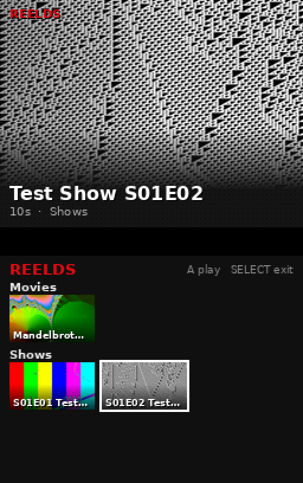

# ReelDS

A tiny Netflix-style video player for Nintendo DSi homebrew. The PC does all the work
(transcoding, scene detection, palettes, thumbnails, fonts, layout); the DSi only reads
bytes from the SD card, copies 4×4 pixel blocks and blits pre-rendered bitmaps.



```
reelds.cmd/.sh    encoder launchers (bundled runtime, any OS)
vendor/           portable Python + numpy + Pillow + ffmpeg per platform
pc/reelds.py      PC builder: encode library -> SD card layout (+ preview/mock tools)
ds/               DSi app (C, BlocksDS)
ds/test/          host-side decoder test
```

## 1. Encode your videos (PC)

Nothing to install: the repo carries a portable Python, numpy, Pillow and ffmpeg for
Windows x64, Linux x64 and macOS (Apple Silicon + Intel) in `vendor/`. The launcher checks
which OS/CPU you're on and unpacks the matching set into `.runtime/` the first time.

**Easiest: double-click `reelds.cmd` (Windows) or `ReelDS.command` (macOS), or run
`./reelds.sh` with no arguments (Linux).** That opens a small window: add your video folders,
pick the SD card, press **Build SD card**. It shows progress, remembers your folders, and
**Preview DSi menu** shows exactly what the DSi's screens will look like (home + every show).
**Arrange rows…** sets the order of the home-screen rows (e.g. Shows before Movies); it's applied
on the next Build, which is quick because nothing is re-encoded. From a terminal:
`build … --row-order Shows Movies` (rows not listed follow A–Z; `reelds rows <folders>` lists them).

Or from a terminal:

```
reelds.cmd build "D:\Videos\Movies" "D:\Videos\Shows" --out E:\          (Windows)
./reelds.sh build ~/Videos/Movies ~/Videos/Shows --out /media/SDCARD         (Linux / macOS)
./reelds.sh selftest                                                         (check the setup)
```

(Already have Python + ffmpeg? `pip install -r pc/requirements.txt` and run `python pc/reelds.py …` directly.)

* Each folder you pass (and each sub-folder inside it) becomes a row.
* **Shows get their own page.** A folder of episodes appears as one tile with an episode
  count; open it with A to get just that show, one row per season (B goes back). A folder
  counts as a show when it has episode-style names (`S01E02`, `1x02`, `Episode 3`), season
  sub-folders (`Season 1`, `S02`, `Specials`), or a `series.txt`:
  ```
  Shows/Ninjago/series.txt            optional: title:, year:, then a description
  Shows/Ninjago/poster.jpg            optional: show artwork (folder/cover/fanart.jpg also work)
  Shows/Ninjago/Season 1/Ninjago S01E01.mkv
  Shows/Ninjago/Season 2/...
  ```
* Re-running is incremental: only new or changed files are encoded. `--prune` deletes
  encoded titles that are no longer in your library. `--force` re-encodes everything.
* Optional sidecars next to a video, same base name:
  * `Movie.jpg/.png/.webp` – artwork (otherwise the best-looking frame is picked automatically)
  * `Movie.txt` – description. Optional first lines `title: …`, `year: …`, `category: …`
* Titles/years are parsed from scene-style file names (`The.Matrix.1999.1080p.BluRay…` → *The Matrix*, 1999).

Useful options:

| option | default | notes |
|---|---|---|
| `--quality low/normal/high` | normal | trades file size for blockiness |
| `--fps N` | 30 | cap; picks source/k so frames drop evenly (59.94 → 29.97, 25 stays 25) |
| `--max-rate KB/s` | 600 | soft cap, keeps the stream inside what the SD card can feed |
| `--audio-rate 16384/32768` | 32768 | both divide the DS sound clock exactly → zero A/V drift |
| `--dither N` | 6 | ordered dither strength, `0` = off |
| `--keyint S` | 5 | max seconds between keyframes (seek granularity) |
| `--jobs N` | cores/2 | parallel encodes |

Check results on the PC before copying:

```
./reelds.sh preview /media/SDCARD/reelds/videos/xxxxxxxx.rdv out.mp4  # bit-exact DSi output
./reelds.sh mock /media/SDCARD screens.png --row 0 --col 1          # browser screens
```

Typical sizes: talking-head / animation ~100–200 KB/s, busy live action 300–600 KB/s,
plus 64 KB/s audio at 32768 Hz (32 KB/s at 16384). A 90-minute film is roughly 0.8–2 GB.

## 2. Get the DSi app

**Just download it:** every push to `main` is built automatically and published as the
**[Latest build](../../releases/latest)** release:
[**reelds.nds**](../../releases/latest/download/reelds.nds). Pushing a tag like `v1.0`
makes a permanent numbered release instead. (`.github/workflows/build.yml` builds it in the
official BlocksDS container and only publishes when the codec test passes too.)

To build it yourself, install [BlocksDS](https://blocksds.skylyrac.net/docs/setup/) then:

```
cd ds && make            # -> reelds.nds
```

Copy `reelds.nds` anywhere on the SD card and launch it from TWiLight Menu++ / Unlaunch /
hiyaCFW in DSi mode (it also runs from a DS flashcart via `fat:/`, at lower CPU speed).

```
SD:/reelds/catalog.bin           written by the PC builder
SD:/reelds/videos/<id>.rdv/.rda  video / audio
SD:/reelds/resume.bin            written by the DSi (resume points)
```

## Controls

**Browser** – D-pad move · L/R jump · A/START or tap twice play / open show · B back · SELECT exit
Closing the lid while a video plays pauses it and the DSi sleeps; open it and press A to carry on.

**Playing** – A/START pause · ◀▶ ±10 s · L/R ±1 min · ▲▼ volume · B back (position saved) ·
SELECT or tap = bottom screen on/off (it also switches off by itself after 5 s to save battery)

### Kid settings

Set in the PC app (section 4) or with `build --autoplay on|off --lock-buttons on|off
--lock-touch on|off --shuffle on|off`. They're saved to `reelds/settings.ini` on the SD card straight away (no
rebuild) and the DSi reads them when ReelDS starts:

| setting | default | effect |
|---|---|---|
| autoplay | on | when an episode ends by itself the next one starts (S01E03 → S02E01 inside a show; films and folders stop at the end of their row). Pressing B stops the chain. |
| lock_buttons | off | while playing, **only A (play/pause) works**. Grown-ups: **hold START + SELECT for 4 seconds** to get back to the menu. |
| lock_touch | off | while playing, the touchscreen does nothing. |
| shuffle_tile | on | a **"Can't decide?" → Shuffle** tile at the top of the menu plays random videos; on a show's page it plays random episodes of that show. It deals from a shuffled deck, so nothing repeats until everything has played, and with autoplay on it keeps picking. |

The locks only apply during playback, so the menu still works for picking a show.

Partially watched titles get a progress bar and show up in a **Continue Watching** row.
Opening a show jumps to the episode you watched last.

## How it stays light

| on the PC | on the DSi |
|---|---|
| decode any format, deinterlace, resize, pick fps | — |
| scene-cut detection, 255-colour palette per scene (5-bit snapped) | copy 512-byte palette on keyframes |
| rate-distortion choice per 4×4 block: skip / fill / 2-colour / raw | 4 aligned word stores per block, decoder in ITCM |
| loudness levelling, resample to an exact divisor of the DS sound clock | stream raw PCM into a looping ring |
| thumbnail scoring, artwork, every string rendered with real fonts | `memcpy`/DMA of BGR555 bitmaps |

Playback is audio-clocked: ARM9 timers 0+1 cascade at exactly the channel's sample rate, so
timer 1 counts samples played. Frames are decoded into RAM, DMA'd into the hidden half of a
double-buffered 8bpp bitmap, and the vblank IRQ flips the buffer (and palette) — no tearing.
If the video falls behind it drops presentation (never decoding) until it catches up.

### `.rdv` format

64-byte header (`RDV1`, w=256, h, fps num/den, frame count, audio rate, audio samples,
keyframe count, keyframe table offset), then per frame: `u32 size`, `u8 flags`
(1 = key, 2 = palette), 3 pad bytes, optional 256×u16 BGR555 palette, then ops:
`op = mode<<6 | (count-1)` with modes SKIP(0 B) / FILL(1 B) / RAW(16 B) / 2-COLOUR(c0, c1,
u16 mask). Missing trailing ops mean "skip". Keyframe table `{u32 frame, u32 offset}` at the end.
`.rda` is raw mono s16le PCM.

## Status / limitations

* **The PC side and the codec are tested** (C decoder, Python decoder and the encoder's own
  reconstruction agree bit-for-bit). The DSi app builds cleanly with BlocksDS (see the Actions
  tab for `reelds.nds`) **but has not been run on real hardware yet**.
* Mono audio only. Each `.rdv` must stay under 2 GB (the encoder refuses beyond that).
* Palettes change at scene cuts; very colourful long scenes can band a little — try
  `--quality high` or a higher `--dither`.

## Make the DSi boot straight into ReelDS

Handy for a kid's DSi: switch it on and ReelDS opens, no menus. Pick one of these.

**With Unlaunch (recommended):** copy `reelds.nds` to the SD card (e.g. `sd:/reelds.nds`).
Power on while holding **A + B** to open Unlaunch's menu, go to **OPTIONS**, set
**NO BUTTON** to `reelds.nds`, then **SAVE & EXIT**. From then on the DSi boots into ReelDS.
To reach your normal menu, set one of the **BUTTON A/B/X/Y** slots to your usual launcher
(TWiLight Menu++ is `sdmc:/BOOT.NDS`, the stock menu is "Launcher") and hold that button while
powering on. Setting **LOAD ERROR** to your launcher too means a missing SD card still boots.

**With TWiLight Menu++ only:** launch ReelDS once, then turn on the *Misc. settings* option
that automatically boots the last played game. Hold **B** at the TWiLight splash screen to
skip it and get the normal menu.

Pair it with the kid settings (locks, autoplay, shuffle). Note that SELECT on the ReelDS menu
still exits the app, which with autoboot drops back to Unlaunch/TWiLight.

## License

ReelDS is free software: you can redistribute it and/or modify it under the terms of the
**GNU General Public License v3.0 or later** — see [`LICENSE`](LICENSE). Bundled third-party
software keeps its own license; see [`THIRD_PARTY_NOTICES.md`](THIRD_PARTY_NOTICES.md).
